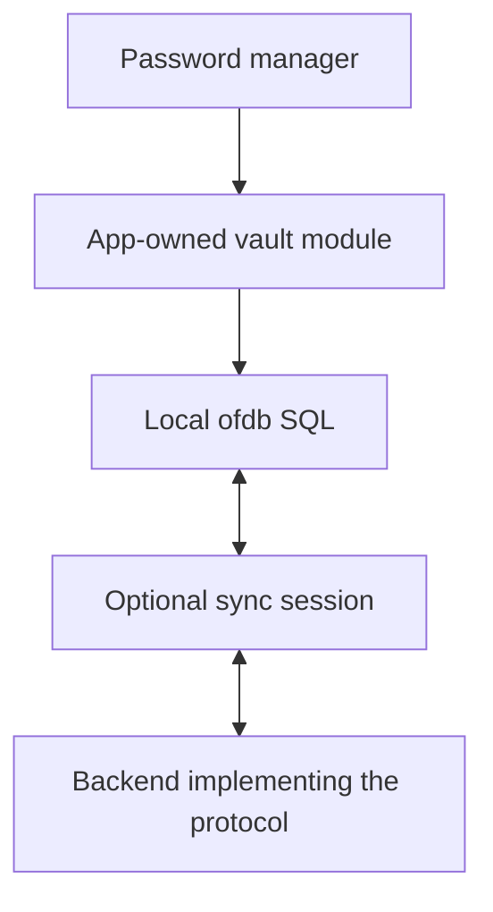

# App-owned data: password manager first

Status: needs-triage

## Goal

An app owns its data, schema, and local persistence. It can start, unlock, read,
and write without an `of` desktop host, Installation, account, or reachable server.
`of` provides optional sync backends that implement a documented protocol.

Prove this with `apps/password-manager` and `packages/storage-db-collection` first.
Use the results to plan service conversion later. This is a proposed replacement,
not a claim that current apps or services already meet it.

## Scope and limits

- First supported runtime: the standalone browser app, with durable local storage.
- Use public `ofdb` SQL/KV and `offs` filesystem interfaces. Do not build another
  persistence engine, CRDT, file protocol, or generic backend framework.
- Use local SQL for this first app. It already has SQL schema and transaction
  behavior. KV is a valid choice for other apps, not a required second store here.
- Do not add filesystem attachments until the app needs them. An encrypted export
  can use a browser download; it does not require an internal filesystem.
- A small `@of/sdk` local setup module may make handles and sync easier to use.
  It must use the public owner interfaces, not replace them with remote CRUD.
- No service conversion, native-host rewrite, general account system, or automatic
  old-data migration in this effort.
- No compatibility wrappers, remote fallback reads, dual writes, or second local
  cache. Delete code made obsolete by the replacement.

## Current evidence

| Area | Current source behavior | Consequence |
| --- | --- | --- |
| App SDK | `apps/password-manager/src/lib/common/state/sdk.ts` configures IdP and Storage bases | Local data access starts with remote identity/configuration |
| App startup | `src/lib/storage/startup.ts` calls `ensureDatabase`, then remote SQL | A browser without a configured Installation cannot prepare the store |
| App collection | `src/lib/collections/secrets/collection.ts` uses a structural SQL client, validates complete snapshots, and batches mutation plus SELECT | Keep its useful transaction and validation behavior; remove the HTTP contract |
| Generic collection | `packages/storage-db-collection/src/index.ts` takes a byte-backend factory and requires User/Application labels | It is not a local SQL collection and the labels should not gate local use |
| Collection adapters | `src/adapters/ofdb.ts` accepts a supplied KV client; `websocket.ts` wraps Storage RPC | Neither opens a qualified local store; RPC is not replication |
| Collection callers | Repository inspection found constructor calls only in its own tests | No app requires preservation of the old byte-backend interface |
| Package docs | Collection README still shows the older `client`/`filesystemId` constructor | Docs are not evidence for the present source contract |
| Local SQL/KV | `../ofdb/packages/sql` and `../ofdb/packages/kv` wrap IndexedDB-backed WASM | Reuse them; qualify the JS contract before app adoption |
| Local files | `../offs/packages/file-system` wraps OPFS content and IndexedDB metadata | Reuse for actual filesystem needs, not SQL emulation |

The path prefix `src/` in app rows means `apps/password-manager/src/`.

### Binding blockers found by source review

These findings have not been reproduced in a browser during this planning task.

- `ofdb/packages/sql/src/wasm.ts` expects `withDeadline`/`cloneClient`; Rust exports
  `with_deadline`/`clone_client`. KV has similar naming differences.
- JavaScript number declarations do not match WASM `u64`/`i64` BigInt parameters.
- `ofdb/crates/wasm/src/value.rs` guesses Blob versus Text by base64 decoding
  strings, and returns integers as JSON numbers. The app needs lossless typed
  values, including ciphertext and identifiers. Do not work around this in the app.
- The high-level SQL/KV JS wrappers do not expose the Rust sync facilities or
  local change subscriptions.
- `offs` Rust browser methods return JSON strings where parts of its TypeScript
  wrapper declare objects. Its high-level class does not expose its declared
  raw sync methods. These are filesystem adoption gates, not SQL-app prerequisites.
- Package sources exist in separate repos and are marked private. A clean build
  needs a reproducible package/WASM artifact path, not hard-coded sibling paths.

Owner browser evidence exists in `ofdb/docs/browser-validation.md`. It does not
qualify the TypeScript package, this app, or an `of` sync backend.

## Design conflict with the current system

`GLOSSARY.md` defines a Node as an Installation member hosting IdP, Management,
Device, and Storage. `docs/design.md` describes that Node model. Storage currently
owns server resource catalogs, namespaces, lifecycle, and authorization.

The proposed local app store is **not** a Node or an Installation resource.
It must not acquire those prerequisites. App ownership means control of local
schema, content, and lifetime; it does not mean that caller-supplied app labels
can bypass a sync backend's authorization.

Leave current service/glossary contracts intact during this proof. After acceptance,
update the applicable named topic docs and glossary terms as part of a separate
service plan. Do not silently redefine Node, Device, or Application here.

## Target ownership

| Owner | Responsibility |
| --- | --- |
| Password manager | Vault identity, unlock, encryption, schema/version, record validation, conflict presentation, import/export, data deletion |
| `ofdb` | Local SQL/KV persistence, transactions, CRDT history, sync codecs and apply rules |
| `offs` | Local filesystem content/metadata and filesystem sync rules |
| `@of/sdk` | Only useful setup/lifetime composition and optional sync configuration; direct owner interfaces remain usable |
| TanStack collection | Validated reactive view and mutation settlement over the local app store |
| Sync backend | Authenticated, authorized exchange of permitted data using the shared protocol |

Local persistence is the source for reads and writes. The collection is a view,
not the durable store. Network loss is a sync state, not a local storage failure.

### Small interface, concrete implementation

1. Start with public `SqlDatabase.open`, its client, and explicit transactions.
   Rewrite the app store around those operations, not the tagged HTTP SQL shape.
2. The vault module hides schema checks, encrypted record encoding, validation,
   and commit outcomes behind the operations the app actually needs: load,
   single-record changes, lock, and disposal. Do not finalize extra methods early.
3. Keep record schema and vault behavior in the app. A generic collection accepts
   a resolved local source plus schema/key behavior; it does not create databases,
   unlock vaults, authenticate, or choose sync backends.
4. Implement and test the app source first. Then rewrite `storage-db-collection`
   around the proven source interface. Remove its old RPC/byte-backend adapters
   and unused contracts. Do not make SQL pretend to be a directory of JSON files.
5. Keep the official TanStack Svelte binding. Distinguish its collection `sync`
   callback from durable owner replication in code and documentation.
6. Add only the SDK setup that removes real app setup work. Use an independent
   local export/module with no required OIDC configuration or token restoration.
   Do not rewrite shared remote clients merely to change this app.
7. No universal SQL/KV/filesystem CRUD interface. Apps choose the owner interface
   that fits their data. No SDK-owned default resource or hidden remote creation.

### Local lifecycle and outcomes

- A fresh app explicitly creates a local vault. Reopen uses its retained identity.
  Different local vaults must not alias because they share an Application URI.
- Distinguish first use, locked, loading, ready-empty, ready, and storage failure.
  Missing/corrupt acknowledged content is not a fresh empty vault. Define retained
  creation evidence and browser-storage-loss limits; do not claim detection when
  the browser removes all evidence with the store.
- Preserve complete validation and atomic mutation/snapshot behavior with an
  actual local transaction. Publish success only after commit completion.
- Handle stale transactions, quota errors, denied browser storage, interrupted
  commits, and malformed records explicitly. Cancellation is not proof of rollback;
  do not blindly replay uncertain writes.
- Use one owner handle per active local store. Cross-tab notifications can
  invalidate a view; they cannot grant write ownership or replace conflict checks.
  Re-read on focus/resume when notifications are absent or incomplete.
- Disposal closes dependent queries before sources and releases handles/listeners.
  Late results must not enter a different vault or unlock session. Add missing
  disposal support at the owner binding, not as a fake no-op app close method.
- Sync account sign-out disconnects sync. It does not erase local data or prevent
  local unlock. Vault lock clears records, drafts, and keys from app access.
  Explicit local deletion and remote deletion remain separate user actions.
- Serve the app as static assets. First download still needs a host. Once installed
  or loaded with an offline asset strategy, reload must work without that host.
  Cache app/WASM assets, never plaintext vault data or authenticated responses.

### Password-manager safety gate

The current app explicitly stores plaintext remotely and is test-only. Do not
turn that into durable plaintext browser storage under a production-vault label.

- Encrypt sensitive records before any persistent write or history capture.
  Keep plaintext only in the unlocked view. Names, URLs, notes, and history are
  sensitive too. Document metadata that remains visible.
- Use a reviewed vault format and established cryptographic facilities. Before
  implementation, record password derivation, authenticated encryption, nonce
  rules, key wrapping, format version, and recovery behavior. No custom crypto.
- Separate local unlock material from optional sync credentials. Backend login
  must not become a required key service for existing local vaults.
- Provide encrypted export and verified restore before recommending durable use.
  Origin/profile changes, quota, eviction, private mode, and cleared site data can
  destroy the only copy. Persistence permission is not backup.
- Preserve conflicting encrypted revisions for explicit recovery. Encryption does
  not provide field-level merges or safe last-writer-wins password edits.
- Deletion is not secure erasure of CRDT history or remote copies. Lock is not a
  guarantee of zeroing JavaScript memory. An unlocked vault remains exposed to XSS.
- Production password storage requires a separate security review. Until then,
  keep the non-sensitive-test-data warning even after functional tests pass.

## Optional sync: protocol requirements, not a service rewrite

After local acceptance, define and prove a minimal backend-neutral exchange contract.
Use the existing owner protocols, rather than inventing JSON CRUD replication.

The contract must state:

1. Protocol/version negotiation and which SQL, KV, or filesystem owner protocol is
   carried. Existing versions differ; do not unify their payloads by assumption.
2. Stable store/replica identity and explicit attach to an existing local vault.
   Account or backend changes must not re-key, replace, or merge unrelated vaults.
3. Authenticated backend identity and authorization for an exact store and direction.
   Local app labels are not credentials. Define enrollment, learned revocation,
   and subsequent-operation checks without requiring a full Node in the browser.
4. A browser-capable reliable ordered transport. Start with one transport proved by
   the harness; WebSocket over TLS is a candidate, not a completed integration.
   Existing Iroh streams alone do not establish browser support.
5. Owner frame/apply limits, backpressure, interruption, cancellation, bounded work,
   partial durable progress, reconnect, and idempotent state reconciliation.
6. Conflict and Tombstone behavior, incompatible schemas, and no silent reset on
   stale, missing, denied, corrupt, or partially available backend state.
7. Visible states: local save pending/saved/failed, independent from sync
   disabled/connecting/pending/current/failed. Define what an acknowledgement proves;
   one backend acknowledgement is not all-device durability or backup.
8. Authorization failure stops exchange, not local editing. Do not add an HTTP
   mutation outbox: the owner's local history is already the replication source.
9. Encrypted records remain opaque to the backend. Document exposed metadata,
   rollback/replay limits, key distribution, and recovery; TLS alone is not E2EE.
10. Filesystem metadata and content availability differ; SQL, KV, and filesystem
    stores do not have a shared cross-store transaction.

Prove SQL first with two independent local app stores and a small test backend.
Use owner protocol compatibility tests for KV/filesystem before claiming them.
The harness is not a new production service. Its result is input to the later
service plan, including what existing `of` adapters can implement unchanged.

## Existing data and deletion scope

- Leave old remote SQL/filesystem records untouched. No fallback reads, automatic
  import, reset, deletion, or dual write. Explain the separate new local vault.
- If old data is needed, plan an explicit authenticated export/import with record
  validation and user consent. It is not a hidden startup dependency.
- Replace app remote preparation/error translation and mandatory auth-route gating.
  Keep optional account routes only where sync setup uses them.
- Rewrite collection source, exports, tests, and README together. Remove its
  Storage-client dependency when the RPC adapter is removed.
- Update app dependencies, aliases/fixtures, build/lockfile, environment docs,
  generated-asset handling, and mounted tests. Do not remove shared SDK/Storage
  clients or native service code still used by other apps.

## Delivery order and acceptance

See [map](map.md) and numbered issues. Each implementation issue must leave a
usable, tested increment. Do not begin production service conversion in parallel.

1. Qualify browser SQL bindings and reproducible package/WASM builds.
2. Build the app-owned encrypted local vault module and test durable reopen.
3. Replace the collection with the proven local-source implementation.
4. Switch app startup/lock/account flows; add only useful SDK setup.
5. Prove browser-only offline operation and data recovery.
6. Draft and test the sync contract; produce the separate service-conversion plan.

The local-app gate requires real-browser reload/restart, no-network CRUD, encrypted
storage inspection, wrong-key/corruption refusal, quota/failure handling, cross-tab
behavior, lock/disposal isolation, encrypted restore, and offline asset loading.
Map-backed fixtures and Node-only tests cannot satisfy it.

The sync gate additionally requires two independent persistent stores, offline
edits on both, interrupted transfer/restart, repeated reconciliation, conflicts,
deletions, denied access, and backend disconnection with continued local editing.
A mock `sync()` method or copied snapshot cannot satisfy it.

## Complexity, risk, priority

- Highest priority: independent local startup and durable, recoverable writes.
- Main complexity: JS/WASM type and lifetime contracts; encrypted record conflict
  handling; optional sync without remote identity leaking into local use.
- Main risks: secret retention, browser data loss, silent replacement of missing
  data, and loss of edits during concurrency or sync. Preserve validation and
  commit semantics even while deleting infrastructure.
- Low-value work excluded: generic plugin registries, universal storage CRUD,
  speculative attachments, broad service refactors, and compatibility layers.

## Validation for implementation

Run focused owner/collection/app tests during each change. Build and type-check
all changed TypeScript packages and the app. Run the existing password-manager,
SDK, and collection tests after callers change; replace remote-only fixtures where
needed rather than treating their pass as local persistence evidence.

For changed Rust owners, run formatting, clippy, browser acceptance, and the repo's
final `cargo hack test --feature-powerset --all-targets` and `just crap` gates.
Document any blocked or failing gate. This planning task runs no runtime tests.
